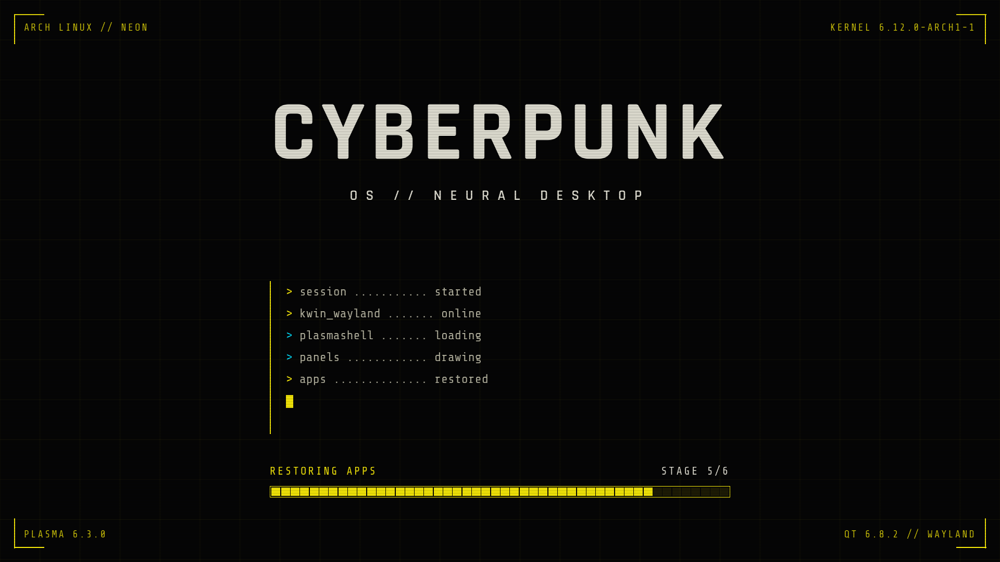
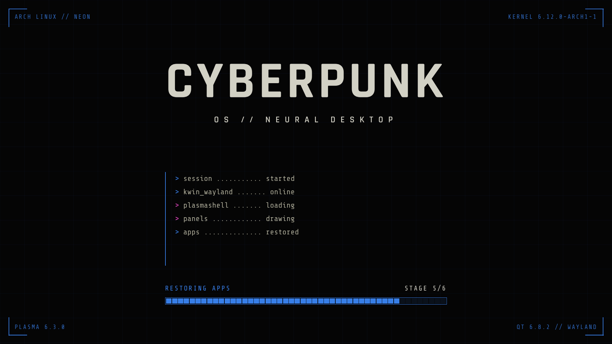

# Cyberpunk Splash

A cyberpunk-style KDE Plasma 6 splash screen for Arch-based systems. It is
driven by Plasma's startup `stage` (0 to 6): a boot log fills in, a segmented
progress bar advances, and the title glitches. Optional CRT effects sit on top.

System details (OS, kernel, hostname, Plasma and Qt versions) and all settings are
written into the theme by a small stamp script, so the splash itself never
reads files at runtime.

## Live preview

**[Try it in your browser](https://causticcatastrophe.github.io/cyberpunk-splash/)**
(animated, with every color and effect option, and a generator for the config
file). The page is a browser approximation of the QML theme; the source is in
`docs/index.html`.

## Screenshots

Default (`ACCENT=yellow`, `SECONDARY=cyan`):



`ACCENT=blue`, `SECONDARY=magenta`:



Stills captured at stage 5 with sample system values (not a real machine). The glitch, tear and
roll effects are animated and only show while it runs.

## Install

Requires Plasma 6 (`plasma-workspace`) and the `base-devel` and `git`
packages to build.

```
cd "$(mktemp -d)"
git clone https://github.com/CausticCatastrophe/cyberpunk-splash
cd cyberpunk-splash
makepkg -si
```

This builds in a temporary directory, so nothing is left in your home folder.
`makepkg` clones the repo again as its build source, builds the package, and
`-si` installs it with pacman (it asks for your sudo password). The install
hook stamps the theme with your system details.

When it finishes, remove the clone (or just let a reboot clear `/tmp`):

```
cd .. && rm -rf cyberpunk-splash
```

To update later, repeat the same steps with a fresh clone.

After installing, open System Settings, Colors & Themes, Splash Screen, and
choose **Cyberpunk Splash**.

Fonts (Rajdhani, Share Tech Mono) are bundled under SIL OFL; no font
packages are needed.

## Configure

Edit the installed config, then re-stamp:

```
sudoedit /etc/cyberpunk-splash.conf
sudo cyberpunk-splash-stamp
```

| Setting | Values | Effect |
|---|---|---|
| `TITLE` | text | Big title on the splash |
| `TAGLINE` | text | Line under the title |
| `USER_NAME` | text, or empty | Shows "WELCOME BACK, NAME" on the last stage. Empty hides it |
| `ACCENT` | name or `#rrggbb` | Main color: HUD, bars, brackets, log markers |
| `SECONDARY` | name or `#rrggbb` | Glitch flashes and some log markers |
| `GLITCH_TITLE` | yes / no | Colored slices flashing across the title |
| `CRT_TEAR` | yes / no | A strip of the screen jumps sideways, frame jitters |
| `CRT_ROLL` | yes / no | Faint light band scrolling down the screen |
| `CRT_FLICKER` | yes / no | Brief brightness dips |
| `SCANLINES` | yes / no | Scanlines over the whole splash |
| `KERNEL_PKGBASE` | e.g. `linux-cachyos`, or empty | Which installed kernel to show. Empty shows the newest |

Color names: yellow, cyan, blue, red, magenta, pink, green, teal, lime,
orange, amber, violet, ice, white.
Invalid colors fall back to the defaults. Values are reduced to a safe
character set before they are written into QML.

The copy of `cyberpunk-splash.conf` in this repo is only the package default.
Editing it changes the next build, not an installed system.
`/etc/cyberpunk-splash.conf` is a pacman backup file, so upgrades keep your
edits and write new defaults to `cyberpunk-splash.conf.pacnew`.

## What the labels show

| Where | Text | Source |
|---|---|---|
| Top left | OS name // hostname | Stamped from `/etc/os-release` and the hostname |
| Top right | Kernel version | Stamped from the installed kernel modules |
| Bottom left | Plasma version | Stamped from the `plasma-workspace` package |
| Bottom right | Qt version // session | Qt version stamped from `qt6-base`; session (Wayland or X11) read live |
| Center | Title and tagline | `TITLE` and `TAGLINE` in the config |
| Progress bar | Startup step and `STAGE n/6` | Plasma's startup stage, read live |
| Progress label, last stage | "WELCOME BACK, NAME" | `USER_NAME` in the config |

A label is hidden when its value is empty, so an unstamped theme never shows
placeholder text.

## Preview

```
ksplashqml --test --window /usr/share/plasma/look-and-feel/org.cyberpunk.splash
```

A test window stays at stage 0 because Plasma is not advancing the stage.

## When the stamp runs

`cyberpunk-splash-stamp` runs automatically (pacman hook, after the
transaction) when a package matching `linux*`, `plasma-workspace`,
`qt6-base`, `filesystem` or `cyberpunk-splash` is installed, upgraded or
removed.
`linux*` also matches `linux-firmware`, which re-stamps harmlessly.

It does not run on its own for a hostname change or a config edit. After
either, run `sudo cyberpunk-splash-stamp`.

The stamp script reads only `/etc/os-release`, the config file, directory
names under `/usr/lib/modules`, the hostname and the versions of the
`plasma-workspace` and `qt6-base` packages. It writes one file:
`/usr/share/plasma/look-and-feel/org.cyberpunk.splash/contents/splash/SystemInfo.qml`.

## Layout

```
PKGBUILD                  package definition
cyberpunk-splash-stamp    writes SystemInfo.qml from the config and system
cyberpunk-splash.hook     pacman hook that triggers the stamp
cyberpunk-splash.conf     default config (installed to /etc)
theme/                    the Plasma look-and-feel package
  metadata.json
  contents/splash/
    Splash.qml            the splash
    SystemInfo.qml        defaults, overwritten by the stamp
    fonts/                bundled fonts and their licenses
```
