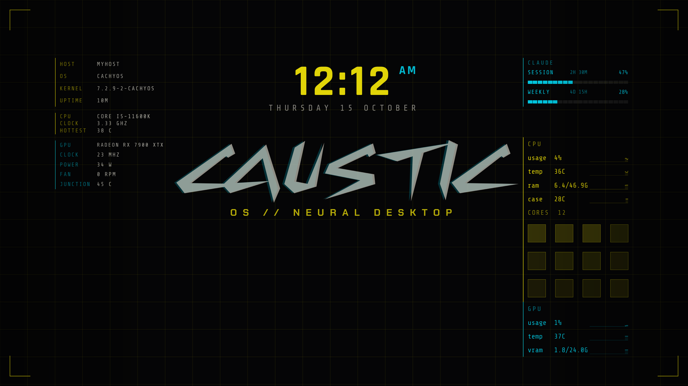

# Cyberpunk Wallpaper

An animated Plasma 6 wallpaper in a cyberpunk HUD style, for the desktop, the lock screen
and the login screen. Its main design shows your machine's real readings: a data terminal
with CPU and GPU usage, temperatures, memory and graphs of their recent history, a CPU
core map, and identity and hardware panels, all aligned to a background grid with the
title and clock kept clear in the middle.

It is a single wallpaper plugin (`org.cyberpunk.wallpaper`). Everything is set in the
wallpaper settings page; there is no system config file and nothing runs as root.



The Data terminal design at 2560x1440, with the title in a custom display font. The hostname
is a placeholder, and the usage bars show sample numbers. The title font is not bundled; see
Fonts below.

## Install

Paste these lines into a terminal and press Enter:

```
sudo pacman -S --needed git base-devel
cd ~
rm -rf cyberpunk-wallpaper
git clone https://github.com/CausticCatastrophe/cyberpunk-wallpaper
cd cyberpunk-wallpaper
makepkg -si
systemctl --user restart plasma-plasmashell
cd ~
rm -rf cyberpunk-wallpaper
```

- It asks for your password. Typing it shows nothing on screen; that is normal. Type it and
  press Enter.
- If it asks "Proceed with installation? [Y/n]", press Enter.
- The `systemctl` line restarts the desktop shell so the wallpaper plugin loads; the panel
  and desktop flicker for a moment.
- The last two lines delete the downloaded files once it is installed.

Coming from the old `cyberpunk-splash` package? This one replaces it. The splash theme and
the boot theme are gone. Switch the splash in System Settings, Splash Screen, if it is still
selected, and if you applied its Plymouth theme go back with
`sudo plymouth-set-default-theme -R <your old theme>`. Settings that lived in
`/etc/cyberpunk-splash.conf` are now set per screen in the wallpaper settings; the old file
can be deleted.

## Use it

Each place keeps its own settings, so each can look different.

- **Desktop** (one per monitor): right-click the desktop, Configure Desktop, set the
  Wallpaper type to Cyberpunk Wallpaper. Changes apply immediately.
- **Lock screen**: System Settings, Screen Locking, Appearance.
- **Login screen**: System Settings, Login Screen. Or in `/etc/plasmalogin.conf` (edit with
  `sudoedit`); note the key is `WallpaperPluginId`, not `WallpaperPlugin`:

```
[Greeter]
WallpaperPluginId=org.cyberpunk.wallpaper

[Greeter][Wallpaper][org.cyberpunk.wallpaper][General]
Accent=#fcee09
Secondary=#02d7f2
ShowClock=false
```

The login screen runs as the `plasmalogin` user, which cannot read your home folder, so
fonts must be installed system-wide there and the live user data of the usage bars is not
available. The login manager's own clock, user picker and blur are drawn over the wallpaper.

## Designs

Pick a **Style** in the settings.

| Style | What it is | GPU cost |
|---|---|---|
| Data terminal | Identity, CPU and GPU panels, live terminal with graphs, CPU core map | about 0.4 points of GPU |
| Hex columns | Hex data down both sides | near zero |
| Terminal | Log in the corner, status block | near zero |
| Classic | Drifting grid, glitch, CRT tear, roll and flicker | high |

Cost follows frames per second, not scene complexity (about 0.07 points of whole-GPU load per
frame per second, measured with `tools/gpu-sample`). Classic redraws at your refresh rate;
the others move a few times a second.

## Data terminal layout

The screen is split into three vertical segments on the background grid. The middle
(25% to 75% of the width) is reserved for the clock, title and tagline, and nothing else enters
it; a wide title font shrinks to fit.

- **Left gutter**, two grid cells in from the edge, in whole grid squares with padding: the
  identity block (host, OS, kernel, session, uptime), a live CPU panel (model, average clock,
  hottest core) and a live GPU panel (model, clock, power, fan, junction temperature).
- **Right gutter**: an optional usage block (below), then one terminal: a CPU group (usage,
  temperature, ram, case temperature), a core map with one tile per core, and a GPU group
  (usage, temperature, vram). Short labels, compact values, a graph beside each value.
- **Bottom margin**: if a panel runs along the bottom of a screen, set Bottom margin on that
  screen (about 4 to 5 percent) so the terminal lifts clear of it.

CPU lines use the accent color, GPU lines the secondary color.

## Settings

All on the settings page, per screen and separately for the lock and login screens:

- Style, clock on or off and 12 or 24 hour
- Title and tagline text, whether they show, font (a searchable list of every installed font),
  size and position
- Accent and secondary colors, grid line strength
- Which log lines to show, how often to read, sparkline step, length, range and smoothing
- The GPU panel and core map on or off
- Sensors: pick the exact sensor behind any reading, including the case temperature, from
  KDE's own sensor list. By default the plugin uses the usual ones. The case temperature has
  none by default; choose one in Sensors.

Readings come from KDE's system monitor service, the same source as the System Monitor
widgets. The identity facts come from `uname`, `/etc/os-release`, `/proc/cpuinfo` and
`pacman -Q`, read once when the wallpaper loads; where a command is not allowed the row is
hidden.

## Fonts

The wallpaper bundles Rajdhani, Share Tech Mono, Oxanium, Chakra Petch and Tektur, all under
the SIL Open Font License (see `wallpaper-plugin/contents/fonts/`). The title and tagline can
use any font installed on your machine. Fonts from other sites often forbid redistribution,
so this project does not bundle them; get the font yourself and check its license.

Install it for your user in `~/.local/share/fonts/` (then `fc-cache`) for the desktop and
lock screen. For the login screen, also install it system-wide, for example in
`/usr/local/share/fonts/`, then `sudo fc-cache`. If a font is missing the title falls back to
Rajdhani. Display fonts often run wide or narrow, so adjust the title size.

## Optional: AI subscription usage bars

A block two grid squares tall above the terminal, with segmented bars for the usage limits of
an AI subscription. Off by default (setting "AI subscription usage"). It reads small local
files and makes no network calls. The feed that writes them for Claude Code lives in
[`usage/`](usage/README.md); it is a separate optional package, never installed with this one.

## Uninstall

```
sudo pacman -Rns cyberpunk-wallpaper
```

That removes everything the package installed (the plugin under
`/usr/share/plasma/wallpapers/org.cyberpunk.wallpaper`). Your settings are yours and stay: the
desktop and lock screen settings in `~/.config`, the login settings in `/etc/plasmalogin.conf`, and
the optional usage files in `~/.local/state/ai-usage`. Before removing, switch each place (desktop,
lock, login) to another wallpaper so none is left pointing at a plugin that is gone; the login
screen falls back to the default if its plugin is missing.

## License

GPL-2.0-or-later, as declared in the package. The bundled fonts keep their own licenses (SIL
Open Font License 1.1); see `wallpaper-plugin/contents/fonts/`.

## Development

```
kpackagetool6 --type Plasma/Wallpaper --upgrade wallpaper-plugin
systemctl --user restart plasma-plasmashell
```

installs your working copy for your user (a user copy overrides the system one, so remove it
with `--remove` when done). `tools/gpu-sample` samples GPU and CPU cost of a running wallpaper.
